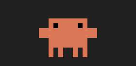

# Clawd Tray

An animated Clawd on your Windows taskbar that shows what Claude Code is doing, so you can tell at a glance whether it is working, finished, or waiting for you.

Unofficial fan project, not affiliated with or endorsed by Anthropic.

<p align="center">
  
</p>

> **About the art:** the preview above shows how Clawd Tray looks. Clawd and its artwork belong to Anthropic and come from the Claude desktop app. They appear here only as a demo. They are not part of the code and not covered by its license, and every build takes them from the Claude app installed on that PC.

## What it shows

| Clawd | When |
|---|---|
| Stands still, blinks now and then | Idle |
| Crouches, pulls out a laptop, types in a loop | Claude Code is working |
| Closes the laptop, puts it away, a green check pops up | The turn finished. Cleared when you click Clawd, switch to the Claude window, or send a new prompt |
| A bobbing `?` | Claude needs you: a question (AskUserQuestion), a plan to approve, a permission prompt, or a turn that ended blocked on your answer |
| A red `!` | The turn ended because of an API error (rate limit, billing, server error) |

With several sessions at once, "needs you" wins over "working", which wins over "error" and "done". The tooltip shows the counts, for example `1 needs you, 2 working`.

## How it works

The installer adds [hooks](https://code.claude.com/docs/en/hooks) to `~/.claude/settings.json` for `SessionStart`, `UserPromptSubmit`, `PreToolUse` (only AskUserQuestion, ExitPlanMode and two desktop-app tools), `PostToolUse`, `PostToolUseFailure`, `PermissionRequest`, `Notification` (permission and elicitation only), `Stop`, `StopFailure` and `SessionEnd`.

Each hook runs `ClawdTray.exe --hook` directly, without a shell. It reads the hook JSON from stdin, passes the event to the running tray process with a window message, and exits after about 10 ms. It prints nothing, so Claude never sees any output and **no tokens are used**.

The tray process is a small native Win32 program. It uses about 1.5 MB of RAM and runs no polling loop: timers only fire while an animation is running.

Windows draws tray icons at 16 px at 100% scaling. To show Clawd bigger (1.5×, 2× or 3×), the app adds a small transparent window to the taskbar, just left of the tray icons. At 1.5× (24 px) it uses the app's art at its original resolution. You can switch back to the plain tray icon from the menu.

## Build

You need:

- Windows 10 or 11
- the **Claude desktop app** installed: the Clawd frames are read from it at build time
- [Node.js](https://nodejs.org/)
- Visual Studio 2019+ or Build Tools with **Desktop development with C++**

```
src\build.cmd
```

This creates `dist\ClawdTray-Setup.exe` (about 180 KB).

`tools/make-frames.js` finds the app's `ion-dist.asar` (Microsoft Store install or `%LOCALAPPDATA%\AnthropicClaude`). It reads the app's own `Clawd-Laptop` pixel-art animation and resamples it so Clawd fills a 16×16 icon. It also keeps a 24×24 copy at the art's original resolution for the 1.5× size, and adds the blink, check, `?` and `!` frames. It writes `src/frames.h` and `src/clawd.ico`.

Clawd is Anthropic's character, so apart from the preview GIF this repo contains no Clawd artwork and publishes no binaries. Every build makes its own frames from the app you already have.

`node tools/make-gif.js` renders the README preview (`docs/demo.gif`) from those generated frames.

## Install

Run `ClawdTray-Setup.exe` and confirm. It will:

- copy itself to `%LOCALAPPDATA%\Programs\ClawdTray\ClawdTray.exe`
- add the hooks to `~/.claude/settings.json` (or `%CLAUDE_CONFIG_DIR%`). It keeps a backup next to it as `settings.json.clawdtray.bak` and leaves your other settings and hooks alone.
- start with Windows, add a **Clawd Tray** shortcut to the Start menu, and add an entry to *Apps & features*
- start Clawd through Explorer, the same way the Start menu would. Closing the terminal or app you ran setup from doesn't take Clawd with it.

Only new Claude Code sessions use the hooks; sessions that are already open keep the hooks they started with.

To hide the original Claude tray icon, go to *Settings → Personalization → Taskbar → Other system tray icons*.

## Menu

Right-click Clawd:

- **Open Claude**: the same as a left click
- **Preview animations**: play each state on demand
- **Size**: 1.5×, 2× or 3× on the taskbar, or the small tray icon only. You can also keep the small tray icon next to the big one.
- **Reset status**, **Start with Windows**, **Uninstall…**
- **Exit**: closes Clawd until you start it again from the Start menu

## If Clawd disappears

Start **Clawd Tray** from the Start menu. If anything other than **Exit** closed it, the next Claude Code hook starts it again on its own (at most once a minute, and only while **Start with Windows** is on).

## Command line

```
ClawdTray.exe --hook            used by the hooks (reads JSON on stdin)
ClawdTray.exe --add-hooks       (re)write only the hooks in settings.json
ClawdTray.exe --remove-hooks    remove only the hooks
ClawdTray.exe --install | --uninstall [--quiet]
ClawdTray.exe --tray            run the tray from any folder (for testing)
```

## Limitations

- Claude Code has no hook for an interrupted turn (Esc or the stop button). If you stop a turn yourself, Clawd keeps working until your next prompt or for 20 minutes, or until you choose **Reset status**.
- The big taskbar Clawd only works with a horizontal taskbar. It is placed just left of the notification area.

## Uninstall

Use *Apps & features → Clawd Tray*, or **Uninstall…** in the menu. It removes the hooks, the autostart entry, its settings and the program.

## License

The code is under the [MIT License](LICENSE). It does not cover Clawd or its artwork, which belong to Anthropic.
